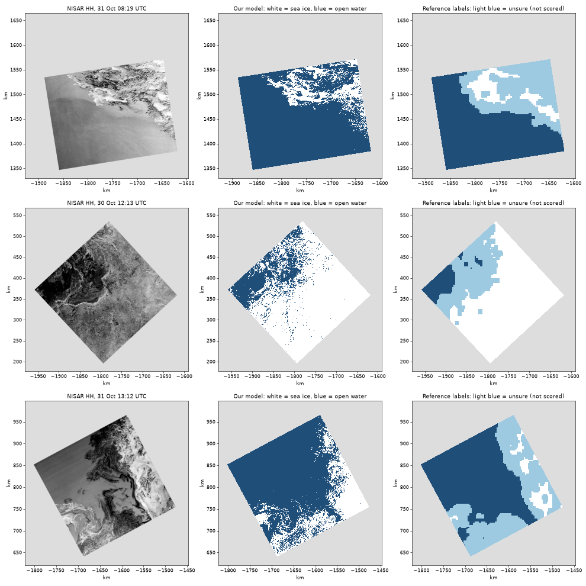
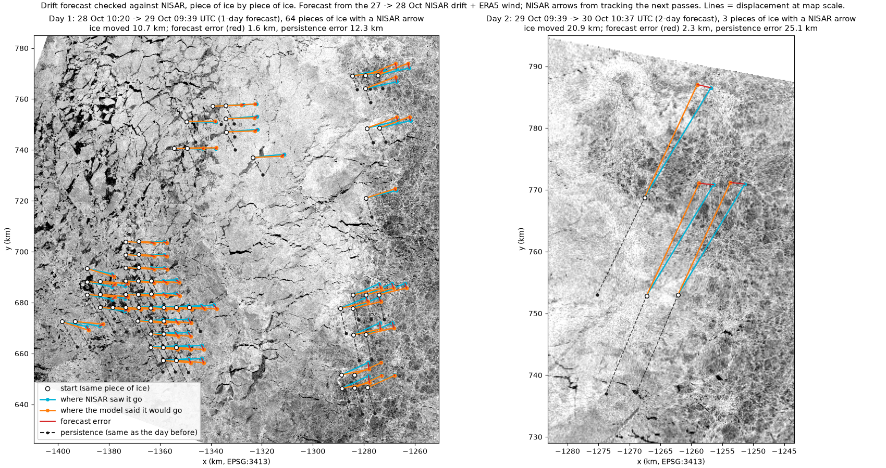
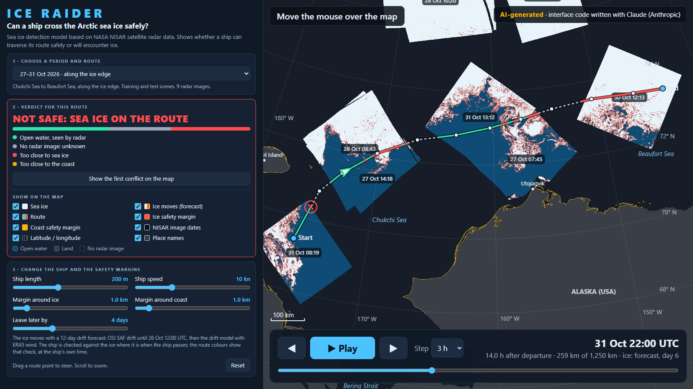

# Ice Raider: can a ship cross the Arctic sea ice safely?

**NASA Space Apps Challenge 2026 · "Dancing with the SARs"**

We detect sea ice in **NASA NISAR** radar images, predict how that ice drifts over the next **12 days**, and check
whether a ship's route stays clear of the ice **at the moment the ship passes**.

**Demo video:**


<video controls width="100%">
  <source src="https://github.com/SweetBoySavage/iceraider/blob/main/IceRaiders_SpaceApps_final.mp4" type="video/mp4">
</video>

<sub><i>The app, two days into a voyage from the Chukchi Sea to the Beaufort Sea. White = sea ice and blue = open
water, both detected by our model in NISAR images; every image drifts with the forecast from the moment it was taken.
Red parts of the route come too close to the ice, green parts are open water seen by radar.</i></sub>

## What it does

1. **Detect** sea ice and open water in NISAR L-band radar images (HH + VV) with a model we trained.
2. **Track** how the ice moved between two NISAR passes a day apart, by matching the radar texture.
3. **Forecast** the drift for 12 days with a small physical model trained on satellite drift and wind data.
4. **Check a route**: the app moves the ice map with the forecast and tests every point of the route against the ice
   where it will be when the ship arrives there, with margins around the ship, the ice and the coast.

## Results

| What | Result | Compared with |
|---|---|---|
| Ice / water detection, locked test (4 NISAR scenes, 29-31 Oct, run once) | **89.6 %** balanced accuracy (water 95.7 %, ice 83.5 %) | 94.3 % on the 22 training scenes, each held out |
| Drift model on years it never saw (2024-2026, 11,541 samples) | error **5.0 km/day** | 12.3 km/day for "the ice keeps yesterday's drift" |
| 1-day forecast vs. drift we tracked in NISAR (28 → 29 Oct, 64 pieces of ice) | off by **1.6 km** after 10.7 km of real motion | 12.3 km for "keeps yesterday's drift" |

On 28 Oct the ice turned by about 70°; the forecast, driven by the wind, got the direction within 6°.

## How it works

### 1. Sea ice detection in NISAR images
Boosted trees on 7 features of NISAR L2 GCOV scenes (80 m pixels): HH, VV, HH minus VV, and their local mean and
spread. Labels come from an independent ice map (AMSR2, University of Bremen), used only where it is clearly ice or
clearly water. 22 scenes for training, 4 later scenes locked away and scored once. Land comes from a coastline, not
from the model. Details: [`docs/DETECTION.md`](docs/DETECTION.md).



### 2. Ice tracking between NISAR passes
Two NISAR images of the same ice, about a day apart, are cut into 10 km patches; each patch is found again in the
second image by phase cross-correlation (coarse, then fine), and kept only if the match is good (similarity ≥ 0.5).
Details: [`docs/ice_tracking.md`](docs/ice_tracking.md).

### 3. Drift forecast
For every piece of ice, step by step (48 h per step):

```
next drift = a × (previous drift) + b × (wind during the next step) + c × (wind during the previous step) + d
```

The coefficients are complex numbers, so each one scales **and turns** a vector, which is how wind moves sea ice.
They are fitted by least squares on 30,769 examples from the autumns of 2018-2025 in the Chukchi and western Beaufort
Sea: ice drift from the **EUMETSAT OSI SAF** low-resolution drift product (62.5 km grid, 48 h) and 10 m wind from the
**ERA5** reanalysis. The model found the classic rule of wind-driven ice by itself: the ice moves at **2.2 % of the
wind speed, 21° to the right of the wind**. We checked it against NISAR drift that it never saw:


<sub><i>Blue = where NISAR saw the ice go, orange = where the model said it would go, red = the error, dashed =
"keeps yesterday's drift". Left: day 1 (64 pieces of ice), right: day 2 (3 pieces).</i></sub>

Details: [`docs/drift_forecast.md`](docs/drift_forecast.md).

### 4. The route app
The NISAR ice maps of 27-31 Oct 2026 are stitched into one map. Every image drifts with the forecast from the moment
it was taken, so the map shows where the ice is at any time in the next 12 days. The ship's route is checked point by
point at the ship's own time, against the ice where it has drifted by then; the page draws the ice with the same
formula the check uses. A **"Leave later by"** slider checks the same route on a later day, up to the latest
departure for which the forecast still covers the whole trip.



## Try it (about 2 minutes)

You need **git** and **Python 3.12 or newer**. No radar data, accounts or database: the maps are in the repo.

```bash
git clone https://github.com/SweetBoySavage/iceraider.git
cd iceraider
python -m venv .venv
source .venv/bin/activate          # Windows: .venv\Scripts\activate
pip install numpy pyproj
python scripts/run_app.py          # opens http://127.0.0.1:8000/
```

Then press **Play**, move **"Leave later by"**, or drag a route point to steer around the ice. A link can open a
given moment, e.g.
`http://127.0.0.1:8000/#scenario=oct&delay=24&t=96` (one day later departure, clock at hour 96).
More: [`docs/INTERFACE.md`](docs/INTERFACE.md).

## Data

| Data | From | Used for |
|---|---|---|
| NISAR L2 GCOV (L-band, HH + VV, 80 m), Sep-Oct 2026 | NASA / ISRO, via NASA ASF DAAC | ice detection, tracking, the app's ice maps |
| AMSR2 ASI sea ice concentration (3.125 km) | University of Bremen | training and test labels for the detection |
| OSI SAF low-resolution sea-ice drift (OSI-405, 62.5 km, 48 h) | EUMETSAT OSI SAF / MET Norway (CC BY 4.0) | training and starting the drift forecast |
| ERA5 hourly 10 m wind | ECMWF / Copernicus, via Open-Meteo | the drift forecast |
| GSHHG coastline | Wessel and Smith (LGPL) | land mask and coast margin |

Full list: [`docs/DATA_SOURCES.md`](docs/DATA_SOURCES.md).

## Limits

- **Best-case forecast.** The 12 days use ERA5, the wind that actually blew, not a weather forecast. A live forecast
  would use forecast winds and be less accurate.
- **Coarse drift.** The drift starts from 62.5 km data interpolated to 10 km: nearby floes move together, and the ice
  does not break, ridge, melt or freeze in the app.
- **The newest ice map is October 2026.** NISAR recorded only VV here from about 1 November, and the detection needs
  HH and VV.
- **Small NISAR check.** The forecast was checked against NISAR on one good day (64 pieces of ice) and one weak day
  (3 pieces).
- **Ice near coasts is not validated**; the strip next to the coast counts as "not verified" in the app.

## Repository

| Where | What |
|---|---|
| [`app/`](app/), [`scripts/run_app.py`](scripts/run_app.py), [`scripts/route_safety.py`](scripts/route_safety.py) | the route app and its safety rules |
| [`scripts/evaluate_detection.py`](scripts/evaluate_detection.py), [`scripts/train_detection.py`](scripts/train_detection.py), [`scripts/detection.py`](scripts/detection.py) | ice detection |
| [`scripts/ice_tracking.py`](scripts/ice_tracking.py), [`scripts/run_chukchi.py`](scripts/run_chukchi.py) | ice tracking |
| [`scripts/drift_model.py`](scripts/drift_model.py), [`scripts/train_drift_model.py`](scripts/train_drift_model.py), [`scripts/forecast_chukchi.py`](scripts/forecast_chukchi.py), [`scripts/forecast_osisaf_interp.py`](scripts/forecast_osisaf_interp.py) | drift forecast |
| [`docs/`](docs/) | how each part works, the data and the choices we made |
| [`tests/`](tests/) | automated tests (`python -m pytest`) |

The repository started from an open learning project on Sentinel-1 sea ice
(`notebooks/sea_ice_sar.ipynb`, unchanged); everything else was built for this challenge.

## Why it matters

As Arctic sea ice retreats, more ships with a low ice class enter the region. Ships can strike ice or be trapped by
it; ice pressure can damage the hull and lead to oil spills, and a trapped ship can drift aground (NASA ARSET, 2023,
[SAR for Detecting and Monitoring Floods, Sea Ice, and Subsidence](https://www.earthdata.nasa.gov/learn/trainings/sar-detecting-monitoring-floods-sea-ice-subsidence-from-groundwater-extraction)).
Knowing where the ice **will be**, not only where it was seen, lets operators plan safer routes before they sail.

## Use of AI

Most of the code and documentation was written with an AI assistant (Claude, Anthropic), directed and checked by the
team. The app shows this on screen. The ice maps are not generated content: they are the output of our own model on
NISAR data.
