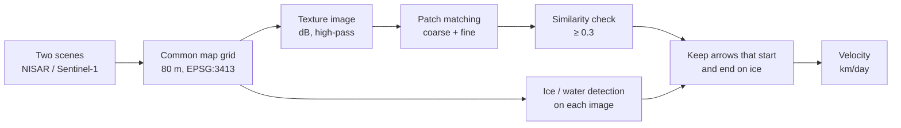

# How the ice tracking works

Sea ice drifts with wind and ocean currents, often 5-20 km per day. To measure that drift, we take two
radar images of the same area a few hours to a day apart, find where each piece of ice moved, and divide
the shift by the time between the images.

Code: [`scripts/ice_tracking.py`](../scripts/ice_tracking.py) (the algorithm) and
[`scripts/run_chukchi.py`](../scripts/run_chukchi.py) (the run on the Chukchi Sea scenes).
Tests: [`tests/test_ice_tracking.py`](../tests/test_ice_tracking.py).



## 1. Put both images on one grid

Tracking compares pixels, so both images must cover the same ground pixel for pixel. NISAR GCOV
products are already on a map grid (polar stereographic, EPSG:3413, 80 m). Sentinel-1 GRD images are in
radar geometry, so they are calibrated to σ⁰ and warped onto the NISAR grid first
([`scripts/s1_geocode.py`](../scripts/s1_geocode.py)). The grid is the area all NISAR scenes share.

## 2. Make a texture image

Radar brightness changes slowly across a scene (viewing angle, sensor differences), and NISAR (L-band)
and Sentinel-1 (C-band) differ in overall brightness. Those differences are not ice motion and would
confuse the matching. So each HH image is:

1. converted to dB,
2. high-pass filtered: a Gaussian blur (σ = 25 pixels = 2 km) is subtracted, which leaves only the
   small-scale pattern of floes, ridges and leads (`texture()` in `run_chukchi.py`, `highpass()` in
   `ice_tracking.py`).

Pixels with no data stay NaN, and any patch that touches them is skipped.

## 3. Match patches (`track()`)

The first image is cut into square patches of 128 × 128 pixels (≈ 10 km), one every 64 pixels (half
overlapping). For each patch we look for the shift that makes it line up best with the second image,
using **phase cross-correlation** (`skimage.registration.phase_cross_correlation`, to 1/10 pixel).

Ice can move further than half a patch in a day, which a single small patch would miss. So there are two
passes:

| Pass | Images | Patch covers | Finds |
|---|---|---|---|
| 1. coarse | both shrunk 4× (4 × 4 pixel averages) | 512 × 512 full-resolution pixels (≈ 41 km) | the rough shift, up to large moves |
| 2. fine | full resolution; the patch of image 2 is read **at the rough shift** | 128 × 128 pixels | the remaining sub-pixel shift |

Total shift = rough + fine. The arrow starts at the patch centre in image 1.

## 4. Reject bad matches

Phase correlation always returns *some* shift, even for two unrelated patches (open water, changed ice,
noise). After shifting, we compute the normalised correlation between the image 1 patch and the image 2
patch at the found position (0 = unrelated, 1 = identical). Arrows below **0.3** are dropped
(`min_similarity`; 0.5 is the function default, `run_chukchi.py` uses 0.3 because L-band and C-band
images of the same ice look less alike).

## 5. Keep only arrows on ice (`keep_on_ice()`)

The tracking itself always runs on the radar texture. Afterwards, an ice / open-water detection is run
on **each image separately**, and an arrow is removed if:

- its **start** (patch centre) is water in the **image 1** ice mask, or
- its **end** (start + shift, rounded to the nearest pixel) is water in the **image 2** ice mask, or
  lies outside the grid.

Why: motion "measured" over open water is not ice drift; it comes from waves or wind patterns, and an
arrow that lands in water most likely matched the wrong thing.

The detection (`ice_mask()` in `run_chukchi.py`) depends on the sensor:

| Sensor | Channels | Water rule | Status |
|---|---|---|---|
| NISAR (L-band) | HH + VV | HH more than 3 dB below VV, after a 7×7 Lee speckle filter | Checked against AMSR2 ice concentration (`verify_chukchi.py`: 89-99 % balanced agreement) |
| Sentinel-1 (C-band) | HH + HV | darkest of 4 k-means classes on HH + HV | **Not validated.** Without incidence-angle correction it also flags ice at steep viewing angles (the dark band on the east side of the Sentinel-1 swaths) |

The rule looks at one pixel at each end. The masks have isolated single "water" pixels from speckle, so a
few good arrows are removed by chance. On the 27-28 Oct scenes (almost all ice) the filter removes 8-12
arrows per pair and changes the median drift by less than 0.1 km/day.

## 6. Convert to velocity (`to_velocity()`)

Shift in pixels × 80 m ÷ time between the two images = velocity. Rows grow downwards in the image but
northwards on the map, so the row direction is flipped. Speed is reported in km/day.

## Pairs in the Chukchi run

| Pair | Gap | What it tests |
|---|---|---|
| NISAR → NISAR (27 → 28 Oct) | 23.3 h | main result, same sensor |
| Sentinel-1 → Sentinel-1 (26 → 27 Oct) | 24.7 h | same sensor, C-band |
| NISAR → Sentinel-1 (27 Oct) | 7.4 h | cross-sensor |
| Sentinel-1 → NISAR (27 → 28 Oct) | 15.9 h | cross-sensor |

Sentinel-1 27 → 29 Oct is left out: after 48 h the ice pattern has changed too much to match.

## Output

`figures/chukchi_ice_motion.png`: one column per pair. Top row: all arrows on the HH image. Bottom row:
arrows kept on ice, image 1's detected water in blue, removed arrows marked with a black ×. Both rows of a
column share one colour scale (km/day).

With MongoDB enabled, the kept arrows are stored in the `ice_motion` collection
([`scripts/mongo_store.py`](../scripts/mongo_store.py)).

## Run it

```bash
python scripts/download_scenes.py       # once; needs a NASA Earthdata login in ~/.netrc
python scripts/run_chukchi.py --no-db   # detection + tracking + figures, without MongoDB
python -m pytest tests/test_ice_tracking.py
```

## Limitations

- **Cross-sensor pairs read fast.** NISAR → Sentinel-1 over 7.4 h gives ≈ 19 km/day, about twice the
  NISAR → NISAR rate. A small geolocation offset between the sensors divided by a short gap inflates the
  speed (3 km / 7.4 h ≈ 10 km/day); this is not corrected.
- **Sentinel-1 → Sentinel-1 finds few matches** (≈ 30 arrows), mostly near the swath edge.
- **One shift per patch.** Rotation and deformation inside a 10 km patch are not measured.
- **The Sentinel-1 water mask is not validated** (see section 5).
