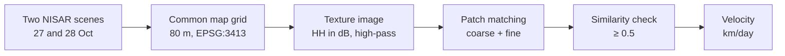

# How the ice tracking works

Sea ice drifts with wind and ocean currents, often 5-20 km per day. To measure that drift, we take two
NISAR radar images of the same area about a day apart, find where each piece of ice moved, and divide
the shift by the time between the images.

Code: [`scripts/ice_tracking.py`](../scripts/ice_tracking.py) (the algorithm) and
[`scripts/run_chukchi.py`](../scripts/run_chukchi.py) (the run on the Chukchi Sea scenes).
Tests: [`tests/test_ice_tracking.py`](../tests/test_ice_tracking.py).



Only NISAR (L-band, HH + VV) is used. The Sentinel-1 scenes that `download_scenes.py` also fetches are
not read by `run_chukchi.py`.

## 1. Put both images on one grid

Tracking compares pixels, so both images must cover the same ground pixel for pixel. NISAR GCOV
products are already on a map grid (polar stereographic, EPSG:3413, 80 m), and the two scenes' grids
are aligned, so we only cut both to the area they share (`common_grid()`, `on_grid()`).

## 2. Make a texture image

Radar brightness changes slowly across a scene (mostly with the viewing angle, which differs between
the two passes). Those changes are not ice motion and would confuse the matching. So each HH image is:

1. converted to dB (`to_db()` in `classify.py`),
2. high-pass filtered: a Gaussian blur (σ = 25 pixels = 2 km) is subtracted, which leaves only the
   small-scale pattern of floes, ridges and leads (`texture()` in `run_chukchi.py`, `highpass()` in
   `ice_tracking.py`).

    I.e., A Gaussian blur replaces every pixel with a weighted average of its neighbours. Averaging over several kilometres wipes out anything smaller than that: individual floes, ridges and cracks. What's left is the slow trend,     the large-scale brightness. That trend is caused by things like the viewing angle (the far side of the swath is darker) or one sensor being brighter overall. Step 2: The subtraction (img - blurred):

    original  =  trend (slow)  +  detail (fine)
    blurred   ≈  trend
    original − blurred  ≈  detail

Pixels with no data are filled with the median before blurring and set back to NaN afterwards; any
patch that touches them is skipped.

## 3. Match patches (`track()`)

The first image is cut into square patches of 128 × 128 pixels (≈ 10 km), one every 64 pixels (half
overlapping). For each patch we look for the shift that makes it line up best with the second image,
using **phase cross-correlation** (`skimage.registration.phase_cross_correlation`, to 1/10 pixel).

Ice can move further than half a patch in a day, which a single small patch would miss. So there are two
passes:

| Pass | Images | Patch covers | Finds |
|---|---|---|---|
| 1. coarse | both shrunk 4× (4 × 4 pixel averages) | 512 × 512 full-resolution pixels (≈ 41 km) | the rough shift, up to large moves |
| 2. fine | full resolution; the patch of image 2 is read **at the rough shift** | 128 × 128 pixels | the remaining sub-pixel shift |

Total shift = rough + fine. The arrow starts at the patch centre in image 1.

## 4. Reject bad matches

Phase correlation always returns *some* shift, even for two unrelated patches (open water, changed ice,
noise). After shifting, we compute the normalised correlation between the image 1 patch and the image 2
patch at the found position (0 = unrelated, 1 = identical). Arrows below **0.5** are dropped
(`min_similarity` in `TRACK`, `run_chukchi.py`). Lowering it (e.g. to 0.3) keeps more arrows at the
cost of more wrong matches: on the 27-28 Oct pair, 0.3 gives 735 arrows and 0.5 gives 176.

**No open-water filter.** An earlier version also removed arrows that started or ended on a pixel
detected as open water (HH more than 3 dB below VV). On this pair (≈ 99 % ice) it removed 5 arrows,
and all 5 had the same shift as their neighbours: they were good arrows whose start or end happened
to fall on a narrow lead or a single speckle pixel. A location rule cannot tell those apart from
real bad matches, and the similarity check already drops most matches over open water (its texture
changes within a day), so the filter was removed. If bad arrows over open water show up near an ice
edge, a check of each arrow against its neighbours' drift is the better fix.

## 5. Convert to velocity (`to_velocity()`)

Shift in pixels × 80 m ÷ time between the two images = velocity. Rows grow downwards in the image but
northwards on the map, so the row direction is flipped. Speed is reported in km/day.

## The Chukchi run

| | |
|---|---|
| Image 1 | NISAR GCOV, 27 Oct 2026 11:01 UTC (ascending) |
| Image 2 | NISAR GCOV, 28 Oct 2026 10:20 UTC (descending) |
| Gap | 23.3 h |
| Area | Chukchi Borderland pack ice, ≈ 75.4-77.5° N, 160-170° W |
| Result | 176 arrows, median 10.6 km/day |

## Output

`figures/chukchi_ice_motion.png`: the arrows on the 27 Oct HH image, coloured by speed (km/day).
Arrows start at the patch centre and point in the direction of motion; their drawn length is set by
the speed (`scale=0.02` in `quiver`), so they are about 60 % of the real 23.3 h displacement.

`figures/chukchi_classes.png`: k-means classes (HH + VV) on the same window in both scenes, with the
28 Oct scene moved back by the median drift so the same ice is compared.

With MongoDB enabled, the arrows are stored in the `ice_motion` collection
([`scripts/mongo_store.py`](../scripts/mongo_store.py)).

## Run it

```bash
python scripts/download_scenes.py       # once; needs a NASA Earthdata login in ~/.netrc
python scripts/run_chukchi.py --no-db   # tracking + classification + figures, without MongoDB
python -m pytest tests/test_ice_tracking.py
```

## Limitations

- **One pair.** Only two overlapping NISAR scenes cover this area, so there is no independent check of
  the drift (e.g. buoys or a second pair).
- **Ascending vs descending.** The two passes look at the ice from opposite sides, so the texture
  differs; this is one reason only 176 patches pass the 0.5 similarity check.
- **One shift per patch.** Rotation and deformation inside a 10 km patch are not measured.
- **Open water is not tested.** The scenes are ≈ 99 % ice, so the tracking has not been checked near an
  ice edge (see "No open-water filter" above).
